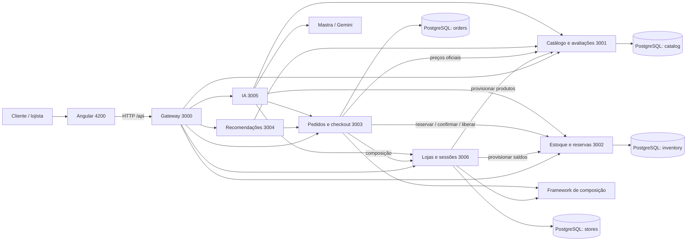
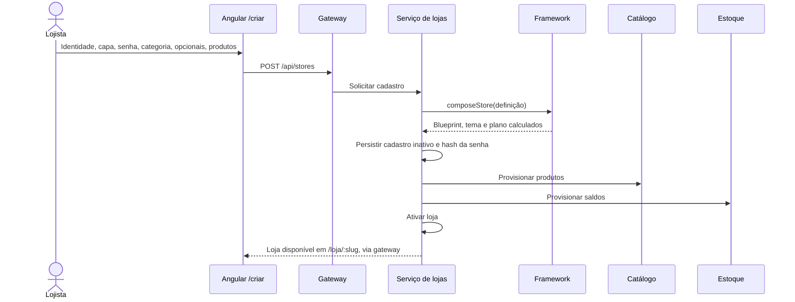
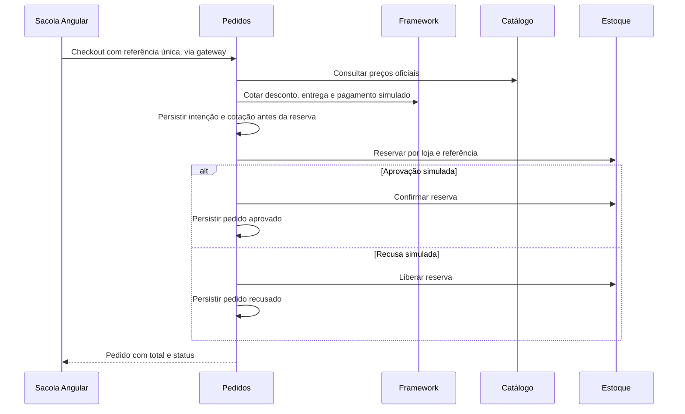

# Arquitetura — lojas dinâmicas

## Contexto e decisão de produto

A plataforma atende uma família de e-commerces configuráveis. O usuário cadastra sua loja pela interface e o framework monta a composição durante a execução. Cada loja tem um endereço estável (`slug`), identidade, categoria, opcionais e senha administrativa. Uma única implantação atende várias lojas, com dados identificados por `store_slug`.

**ADR-009, 05/11/2026:** a solicitação de cadastro dinâmico substitui a antiga ADR-003 (um perfil por implantação). As lojas Essencial e Assistida em código permanecem exemplos didáticos; `ConfiguredStore` é o produto parametrizado usado no cadastro operacional. Não há contêiner ou build Angular por loja.

## Serviços e propriedade dos dados

Cada domínio acessa apenas seu próprio schema. Não há consultas SQL entre schemas de domínio. Para a demonstração, uma instância PostgreSQL e um usuário são compartilhados; a separação é arquitetural, sem ACL de banco por serviço. Recomendações, gateway e IA não armazenam entidades próprias de domínio. O pacote `platform` compartilha somente infraestrutura e validação.

## Cadastro e composição

O cadastro exige pelo menos um produto. Se o provisionamento falhar, o serviço tenta compensar catálogo e estoque antes de liberar o endereço. A loja não é exibida enquanto estiver inativa. A composição e o preço são recalculados no servidor; valores informados pelo cliente não definem o plano.

## Administração e isolamento

O acesso é feito por `/admin/:slug` com a senha da loja. O serviço de lojas usa scrypt com salt aleatório; só o hash é persistido. A sessão usa token aleatório de 256 bits, cujo hash fica no banco, com validade de sete dias. O gateway devolve cookie `HttpOnly`, `SameSite=Strict` e caminho limitado à API da loja. O logout revoga a sessão no servidor.

Toda mutação administrativa verifica a associação entre sessão e loja. Endpoints internos exigem `INTERNAL_API_KEY`. No Docker, somente frontend, gateway e a porta local do PostgreSQL são publicados. O uso direto dos serviços locais é restrito a `127.0.0.1` por padrão. O gateway limita tentativas de login, geração, cadastro, checkout e avaliações por IP em memória.

O painel oferece produtos/estoque, pedidos, configurações e agente opcional. Nome, descrição, capa, categoria e opções podem mudar; o endereço permanece fixo. Não há recuperação de senha, cadastro de usuários finais ou gateway financeiro externo.

## Checkout e retentativas

O estoque é descontado na reserva com atualização condicional e transação; nunca pode ficar negativo. Locks por referência serializam retentativas. A intenção durável conserva itens, valor e resultado simulado; confirmar/liberar são idempotentes. Repetir uma compra concluída devolve o mesmo pedido. Se houver falha após uma reserva, a repetição da mesma tentativa retoma a operação. Ainda não existe worker automático para reconciliar tentativas abandonadas.

## Implantação e desenvolvimento

O Compose inicia PostgreSQL, sete processos NestJS e Nginx com Angular. O banco é publicado na porta **5433** do host (5432 interna), para evitar conflito comum com outros projetos. As portas padrão da interface e gateway são 4200 e 3000. `FRONTEND_PORT`, `GATEWAY_PORT` e `POSTGRES_PORT` permitem ajustar o host. No desenvolvimento local, os serviços usam 3000–3006.

As credenciais de banco no Compose são exclusivamente locais e educacionais. Valores de planos, vendas e pagamentos são fictícios. Configuração de produção, armazenamento de mídia dedicado e autorização distribuída por credenciais de banco não fazem parte desta entrega.
