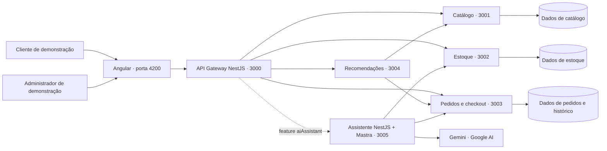
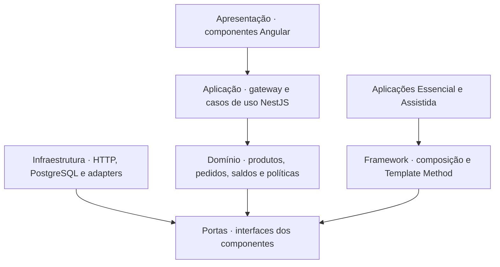
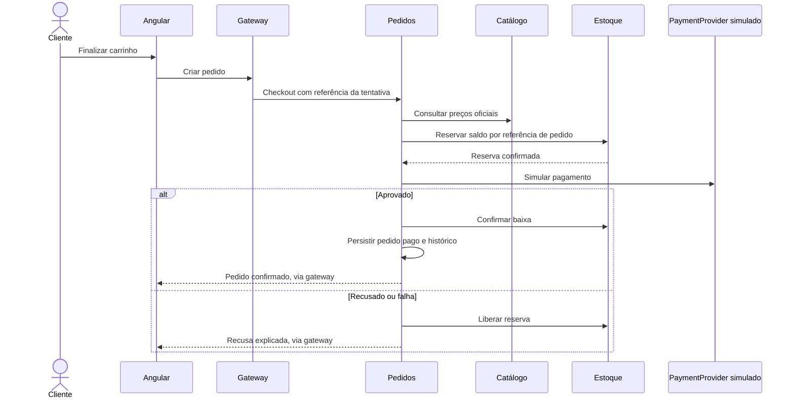

# Arquitetura do Gerar Commerce

## Objetivo e limites

Construir uma **linha de produtos de lojas de e-commerce** e um **framework reutilizável** que sustente essa família. O domínio comum e as variantes atendem aos dois trabalhos. A demonstração usa dados sintéticos, uma persona de cliente, uma persona administrativa e pagamento simulado. Finalização prevista em 10/11/2026.

O repositório tem dois projetos com instalações independentes: `frontend/` contém Angular; `backend/` contém os serviços NestJS e o framework. Cada lado tem manifesto npm, lockfile, `node_modules` e Dockerfile próprios. A interface consome contratos HTTP, sem importar pacotes do backend.

Dentro de `backend/`, os serviços e pacotes reutilizáveis pertencem a um workspace npm exclusivo do servidor. Cada microsserviço NestJS é iniciado e implantado separadamente. O compartilhamento interno se restringe a contratos públicos, composição do framework e infraestrutura técnica; entidades de persistência e regras de cada domínio pertencem ao próprio serviço.

## Contexto e contêineres

No incremento inicial, os dados são fixtures em memória. O destino é PostgreSQL com banco/schema de propriedade exclusiva de cada serviço de domínio, usando uma instância física local para reduzir consumo. **Nenhum serviço deve consultar tabelas de outro serviço**; integrações utilizam HTTP. Recomendações inicialmente não têm banco próprio: consultam APIs. IA não recebe credenciais de banco.

## Camadas e direção das dependências

As camadas de domínio/persistência completas são o desenho de destino para o ciclo I2. Os controladores atuais concentram os casos de leitura de demonstração; não representam a estrutura final dos casos transacionais.

| Aplicação       | Responsabilidade                                                 |          Porta interna | Dados atuais → destino        |
| --------------- | ---------------------------------------------------------------- | ---------------------: | ----------------------------- |
| storefront      | Vitrine, carrinho, configuração e administração                  | 4200 / 80 no contêiner | Estado de interface           |
| gateway         | Contratos externos, composição, seleção de perfil e guarda da IA |                   3000 | Sem banco                     |
| catalog         | Produtos, categorias e preços oficiais                           |                   3001 | Memória → PostgreSQL catálogo |
| inventory       | Saldos, reservas e liberações                                    |                   3002 | Memória → PostgreSQL estoque  |
| orders          | Checkout, pedido, pagamento simulado e histórico                 |                   3003 | Memória → PostgreSQL pedidos  |
| recommendations | Recomendação baseada no histórico                                |                   3004 | Consulta APIs                 |
| ai-assistant    | Consultas administrativas via ferramentas Mastra                 |                   3005 | Sem banco; Gemini externo     |

Todos os backends usam TypeScript/NestJS. O frontend usa Angular. O serviço de IA usa NestJS na borda HTTP e Mastra para o agente e as ferramentas.

## Fluxo de compra de destino — ainda no backlog

No protótipo, HTTP com timeouts é suficiente para tornar a separação observável. A reserva precisa ter referência idempotente e saldo não negativo. Não haverá transação distribuída envolvendo todos os bancos. Filas, event sourcing e Kubernetes não são necessários para esta entrega.

## Decisões registradas

1. **ADR-001 — frontend e backend com dependências independentes.** Cada projeto instala e compila sozinho. Somente o backend usa um workspace npm interno para serviços e pacotes reutilizáveis.
2. **ADR-002 — um domínio por serviço.** Catálogo, estoque, pedidos e recomendação separados. Carrinho pode ficar no Angular nesta versão; pagamento e entrega são componentes de checkout, sem criar serviços extras.
3. **ADR-003 — variabilidade por produto na inicialização.** Cada perfil configura uma implantação; a prévia não muda a loja ativa. Não implementar SaaS multi-tenant neste prazo.
4. **ADR-004 — framework com fluxo controlado.** `CommerceApplication.build()` organiza validação, registro do core, extensões e política de entrega. As subclasses implementam hotspots; não copiam serviços.
5. **ADR-005 — recomendação obrigatória por exigência do relatório.** Algoritmo explicável por histórico/categoria; não depende de LLM.
6. **ADR-006 — IA opcional e administrativa.** Mastra + Gemini consultam APIs de leitura; sem SQL arbitrário e sem alteração automática de estoque/pedidos.
7. **ADR-007 — autenticação de demonstração e pagamento simulado.** Concentra esforço em reuso, variabilidade, comunicação e fluxo de compra. Não incluir cadastro complexo ou integração financeira real.
8. **ADR-008 — Kanban com ciclos de entrega.** Colunas e WIP controlam o fluxo; snapshots por ciclo atendem ao requisito de Sprint Backlog dos modelos acadêmicos.
