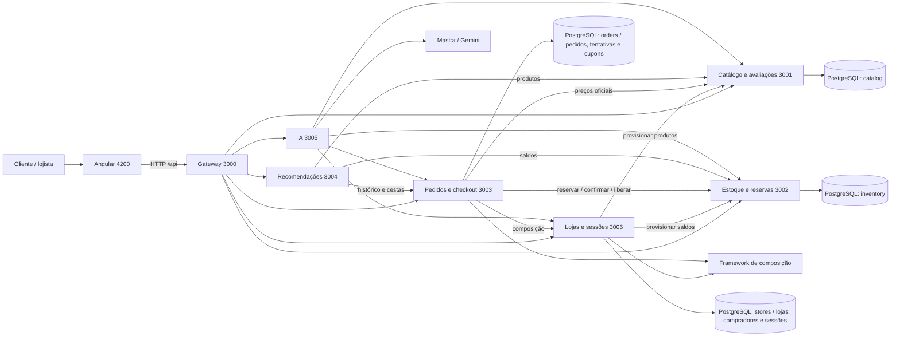
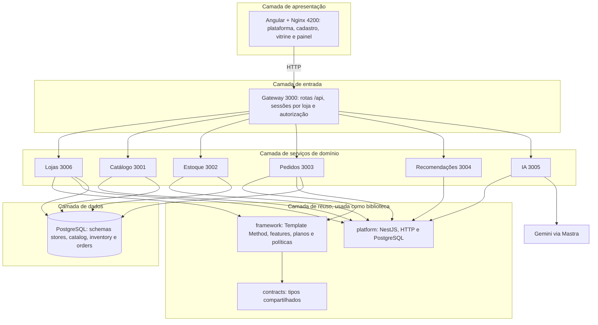
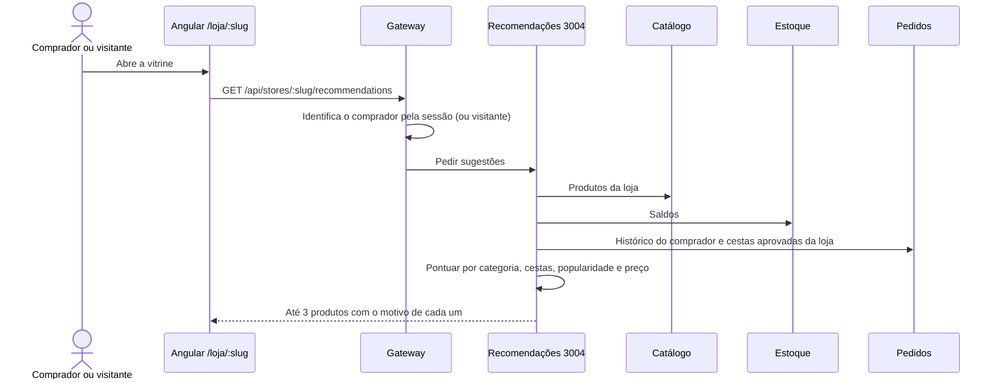
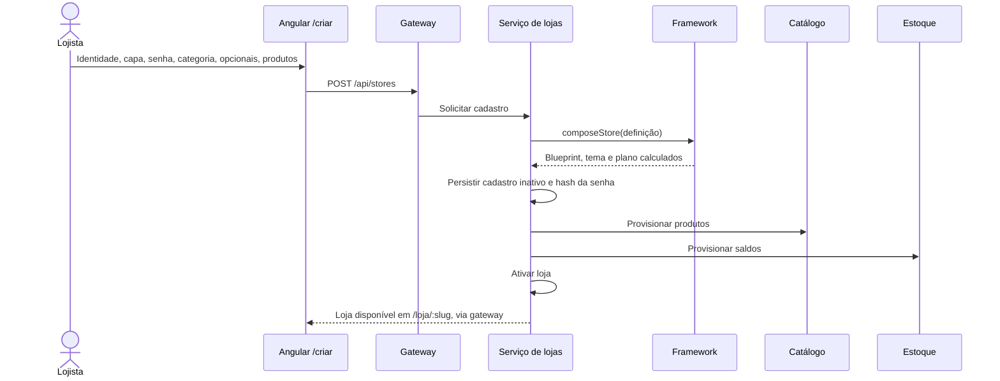
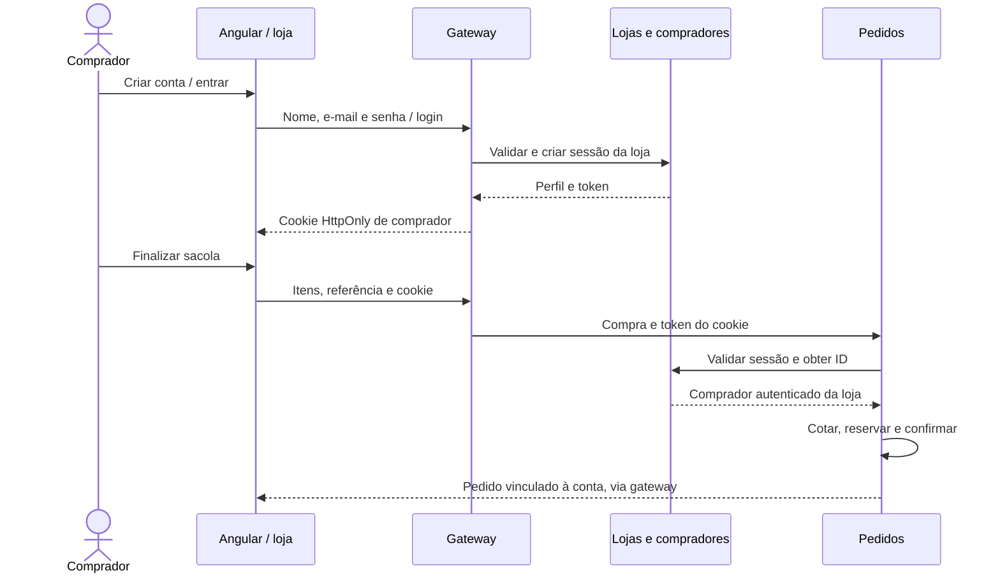
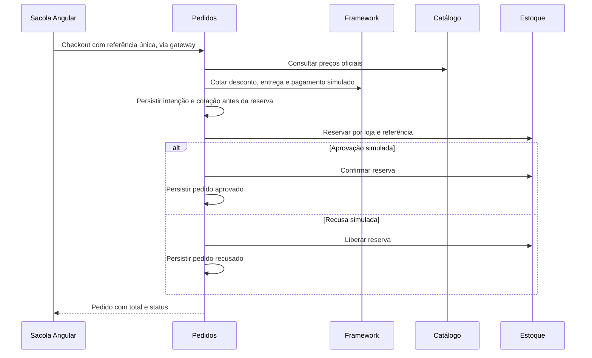

# Arquitetura — lojas dinâmicas

## Contexto e decisão de produto

A plataforma atende uma família de e-commerces configuráveis. O usuário cadastra sua loja pela interface e o framework monta a composição durante a execução. Cada loja tem um endereço estável (`slug`), identidade, categoria, opcionais e senha administrativa. Uma única implantação atende várias lojas, com dados identificados por `store_slug`.

**ADR-009, 05/11/2026:** a solicitação de cadastro dinâmico substitui a antiga ADR-003 (um perfil por implantação). As lojas Essencial e Assistida em código permanecem exemplos didáticos; `ConfiguredStore` é o produto parametrizado usado no cadastro operacional. Não há contêiner ou build Angular por loja.

## Serviços e propriedade dos dados

Cada domínio acessa apenas seu próprio schema. Não há consultas SQL entre schemas de domínio. Para a demonstração, uma instância PostgreSQL e um usuário são compartilhados; a separação é arquitetural, sem ACL de banco por serviço. Gateway e IA não armazenam entidades próprias de domínio. O pacote `platform` compartilha somente infraestrutura e validação.

## Arquitetura em camadas

Cada camada só conversa com a vizinha: a interface fala apenas com o gateway, e o gateway é o único ponto de entrada para os serviços. O framework e os pacotes de apoio não rodam como serviços; são compilados dentro de cada serviço que os usa. Recomendações e IA não têm schema próprio. A variabilidade de cada camada está em [variabilidade.md](variabilidade.md).

## Recomendações

O serviço não tem banco próprio: deriva tudo dos dados de catálogo, estoque e pedidos. Detalhes do ranking e da migração das lojas antigas estão no ADR-011.

## Cadastro e composição

O cadastro exige pelo menos um produto. Se o provisionamento falhar, o serviço tenta compensar catálogo e estoque antes de liberar o endereço. A loja não é exibida enquanto estiver inativa. A composição e o preço são recalculados no servidor; valores informados pelo cliente não definem o plano.

## Administração e isolamento

O acesso é feito por `/admin/:slug` com a senha da loja. O serviço de lojas usa scrypt com salt aleatório; só o hash é persistido. A sessão usa token aleatório de 256 bits, cujo hash fica no banco, com validade de sete dias. O gateway devolve cookie `HttpOnly`, `SameSite=Strict` e caminho limitado à API da loja. O logout revoga a sessão no servidor.

Toda mutação administrativa verifica a associação entre sessão e loja. Endpoints internos exigem `INTERNAL_API_KEY`. No Docker, somente frontend, gateway e a porta local do PostgreSQL são publicados. O uso direto dos serviços locais é restrito a `127.0.0.1` por padrão. O gateway limita tentativas de login, geração, cadastro, checkout e avaliações por IP em memória.

No Angular, `StoreSessions` compartilha o estado confirmado pelas APIs entre cabeçalho, vitrine e painel. O cabeçalho distingue o comprador do administrador e chama os endpoints de logout separadamente; encerrar uma sessão não encerra a outra. O estado visual não substitui a autorização dos serviços. O login da finalização pausa a sacola e os diálogos coordenam foco e rolagem durante a transição.

O painel oferece produtos/estoque, pedidos, cupons, configurações e agente opcional. Nome, descrição, capa, categoria e opções podem mudar; o endereço permanece fixo. Não há recuperação de senha ou gateway financeiro externo.

**Evolução de 09/11/2026:** compradores possuem contas por loja, com nome, e-mail normalizado e senha scrypt. O schema `stores` mantém `customers` e `customer_sessions`; contas administrativas e de compradores têm cookies e sessões separados. A navegação é pública e a finalização exige comprador autenticado. O serviço de pedidos valida a sessão pela API de lojas e usa o ID retornado, sem confiar no ID do navegador. Histórico pessoal e avaliações usam essa identidade.

Cupons pertencem ao schema `orders`, com código por loja, percentual, compra mínima, validade e ativação. O painel exige autorização administrativa para mutações. O checkout resolve o cupom persistido e o framework aplica a política `PercentageDiscount`; uma prévia no navegador não autoriza desconto.

O opcional `aiAssistant` disponibiliza agente administrativo e chat público de produtos. O público recebe somente catálogo e disponibilidade; não reutiliza ferramentas de vendas do administrador. Após Gemini sugerir IDs, o backend os filtra contra o catálogo da loja e constrói links locais `/loja/:slug/produto/:id`. Fotos sugeridas vêm de URLs ilustrativas conhecidas, identificadas como tal. Enquadramento e origem da imagem são persistidos junto da entidade; upload é otimizado no navegador.

## Checkout e retentativas

O estoque é descontado na reserva com atualização condicional e transação; nunca pode ficar negativo. Locks por referência serializam retentativas. A intenção durável conserva itens, valor e resultado simulado; confirmar/liberar são idempotentes. Repetir uma compra concluída devolve o mesmo pedido. Se houver falha após uma reserva, a repetição da mesma tentativa retoma a operação. Ainda não existe worker automático para reconciliar tentativas abandonadas.

## Implantação e desenvolvimento

O Compose inicia PostgreSQL, sete processos NestJS e Nginx com Angular, em nove contêineres. O banco é publicado na porta **5433** do host (5432 interna), para evitar conflito comum com outros projetos. As portas padrão da interface e gateway são 4200 e 3000. `FRONTEND_PORT`, `GATEWAY_PORT` e `POSTGRES_PORT` permitem ajustar o host. No desenvolvimento local, os serviços usam 3000–3006.

As credenciais de banco no Compose são exclusivamente locais e educacionais. Valores de planos, vendas e pagamentos são fictícios. Configuração de produção, armazenamento de mídia dedicado e autorização distribuída por credenciais de banco não fazem parte desta entrega.

## Ajustes de navegação e avaliações — 10/11/2026

Na vitrine, somente o menu da própria loja é mostrado. O cabeçalho e o resumo de perfis da plataforma não são repetidos; os logouts independentes continuam disponíveis nas contas e no painel. O link da coleção mantém /loja/:slug#colecao e a rolagem aguarda a renderização do catálogo.

ADR-010: as recomendações automáticas foram retiradas por solicitação do usuário. O core passa a ter seis funcionalidades. O serviço e as rotas de recomendações são removidos, e os blueprints antigos são atualizados preservando os cadastros. O chat opcional Gemini é um recurso distinto e permanece disponível.

O catálogo valida a sessão do comprador pela API de lojas e consulta a API de pedidos para confirmar compra aprovada do produto, loja e comprador, sem limitar a consulta aos últimos 100 pedidos. Nome e identidade enviados pelo navegador não autorizam a publicação. O nome público vem da conta. Avaliações anteriores à regra são preservadas sem selo de compra verificada.

ADR-011: o serviço de recomendações volta como funcionalidade core (sete no total), porque o modelo da disciplina exige um microsserviço de recomendação por histórico. A versão anterior sugeria produtos da mesma categoria; a atual (`services/recommendations`) pontua cada produto em estoque e ainda não comprado por: categorias já compradas (peso 3), "quem comprou X também comprou Y" nas cestas aprovadas da loja (peso 2), popularidade na loja (0,5) e proximidade com o preço médio pago (0,5). Cada sugestão traz o motivo exibido na vitrine. O serviço consulta catálogo, estoque e pedidos por HTTP; pedidos expõe, sem dados de compradores, apenas as cestas (`/internal/stores/:slug/baskets`). Lojas cadastradas durante a retirada são recompostas na inicialização do serviço de lojas, sem perder dados. O ADR-010 fica como registro histórico, substituído por este.
