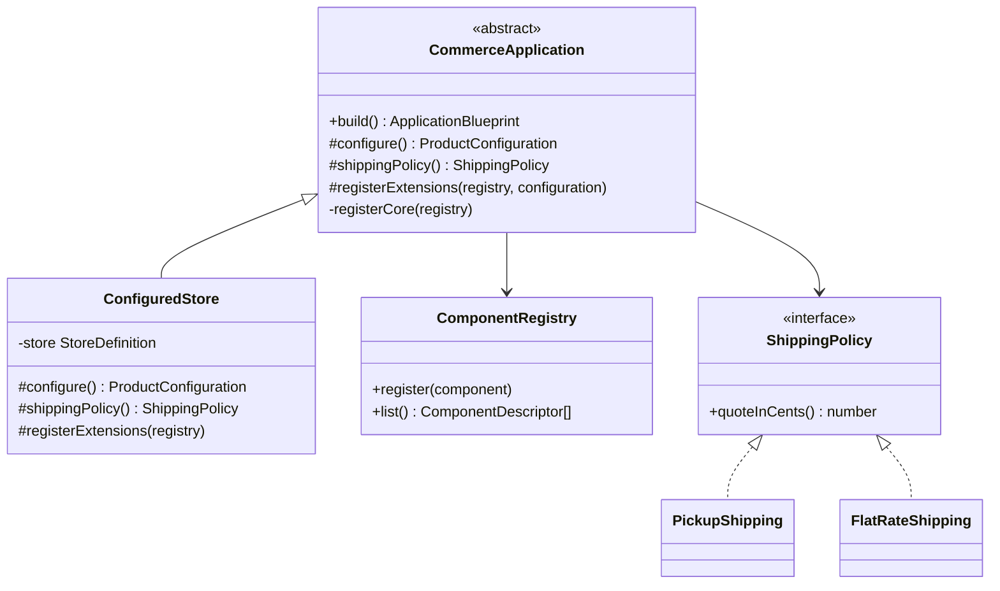
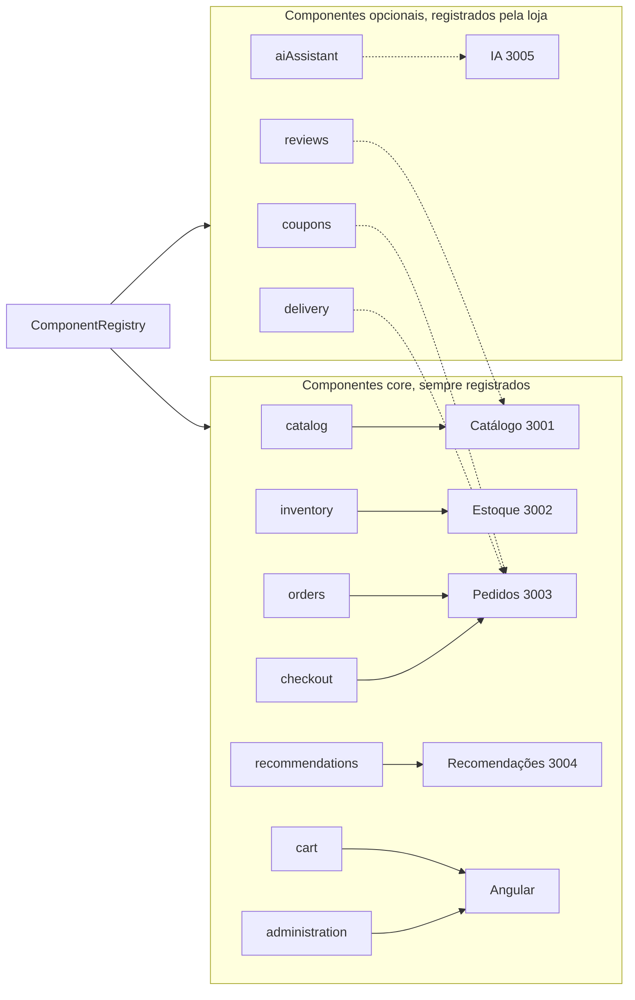
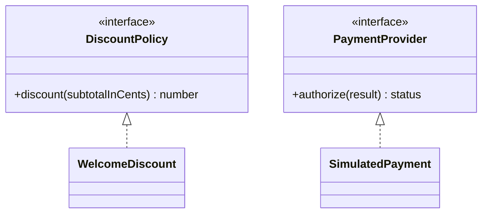

# Framework e componentes de software

## Código reutilizável

O pacote `backend/packages/framework/` não inicia NestJS, não acessa PostgreSQL e não conhece componentes Angular. Ele fornece o fluxo de construção dos produtos, as restrições de composição e políticas reutilizáveis.

| Arquivo                  | Responsabilidade                                                                                                         |
| ------------------------ | ------------------------------------------------------------------------------------------------------------------------ |
| `src/core.ts`            | `CommerceApplication`, Template Method, registro de componentes e validação comum; exemplos EssentialStore/AssistedStore |
| `src/dynamic.ts`         | Catálogo de features, categorias, `ConfiguredStore`, composição dinâmica, plano, desconto e pagamento simulado           |
| `src/index.ts`           | API pública do pacote                                                                                                    |
| `test/framework.test.ts` | Restrições, reuso, categorias, preços e políticas                                                                        |

`backend/packages/contracts/src/index.ts` define `Feature`, `ProductConfiguration`, `ComponentDescriptor` e `ApplicationBlueprint`. `platform` é infraestrutura, não o framework de negócio.

## Template Method e hotspots



`build()` controla a sequência: configurar, validar, registrar core, registrar extensões, verificar correspondência entre componentes e features e calcular entrega. `ConfiguredStore` adapta os hotspots usando a definição cadastrada; não sobrescreve o fluxo comum nem copia os serviços.

## Componentes e variabilidade



O `ComponentRegistry` guarda cada componente com a feature que o justifica e o serviço que o implementa. Os sete componentes core são registrados por `registerCore()`, na classe base. Os opcionais entram em `registerExtensions()`, o hotspot que `ConfiguredStore` preenche a partir das opções da loja. As linhas tracejadas indicam variantes: sem a opção, o componente não é registrado e o backend recusa o seu uso. `cart` e `administration` pertencem à interface Angular; os demais ficam em microsserviços.

## Derivação em tempo de execução

```typescript
import { composeStore } from '@gerar/framework';

const blueprint = composeStore({
  slug: 'aurora-studio',
  name: 'Aurora Studio',
  category: 'roupas',
  options: ['reviews', 'coupons'],
});
// Core obrigatório + avaliações + cupons; tema de roupas; plano R$ 79,90.
```

O serviço de lojas chama essa função ao cadastrar e alterar configurações, persiste a definição e o blueprint e disponibiliza o produto por `/loja/:slug`. O Angular renderiza tema e componentes a partir dessa resposta. O gateway usa a composição para permitir opcionais. O checkout também consulta a composição atual e aplica `quoteCheckout()`.

O registry descreve a composição; as implementações dos componentes executam nos serviços. Por exemplo, avaliações são registradas para `catalog`, agente para `ai-assistant` e cupons/entrega para `orders`. As políticas efetivas são aplicadas pelos componentes, não apenas exibidas como rótulos.

## Políticas de negócio



- `calculatePlan`: R$ 59,90 sem opcionais; R$ 79,90 com opcionais sem agente; R$ 99,90 com agente, independentemente dos outros adicionais.
- `quoteCheckout`: valida disponibilidade de cupom/entrega, aplica o percentual do cupom válido e a política de entrega de R$ 15,00; retirada gratuita.
- Na evolução de 09/11, o percentual fixo foi substituído por `CouponDefinition` e `PercentageDiscount`. Pedidos fornece o cupom cadastrado na loja; o framework verifica código, ativação, validade, mínimo e percentual. Sem definição válida não há desconto. `WelcomeDiscount` permanece como exemplo didático.
- `SimulatedPayment`: aprovação/recusa explícitas, sem dados financeiros reais.

## Extensão da família

Para uma nova feature, adicione o contrato, a descrição no catálogo, a validação de opções, o registro do componente, o comportamento no serviço responsável e a renderização da interface. Acrescente testes que comprovem habilitação e bloqueio. Uma nova categoria adiciona um tema sem duplicar a aplicação. Hotspots adicionais podem ser implementados por subclasses de `CommerceApplication` ou novas políticas.

Os exemplos `EssentialStore` e `AssistedStore` preservam a demonstração original de herança e reuso. Os produtos operacionais atuais são as definições persistidas de `ConfiguredStore`; não exigem alteração de código para cada lojista.

`npm run derive -- <slug>` exporta um snapshot de uma loja já cadastrada para `backend/output/products/<slug>/`. O cadastro na plataforma é quem efetivamente cria a loja.
