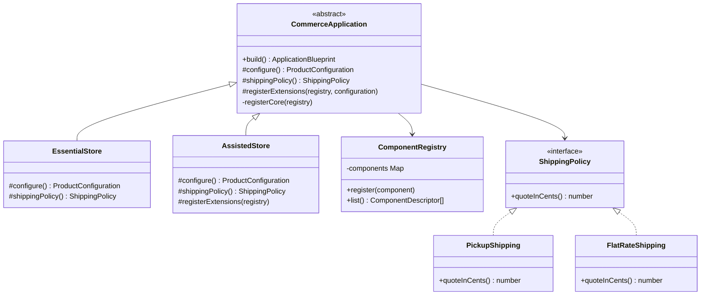
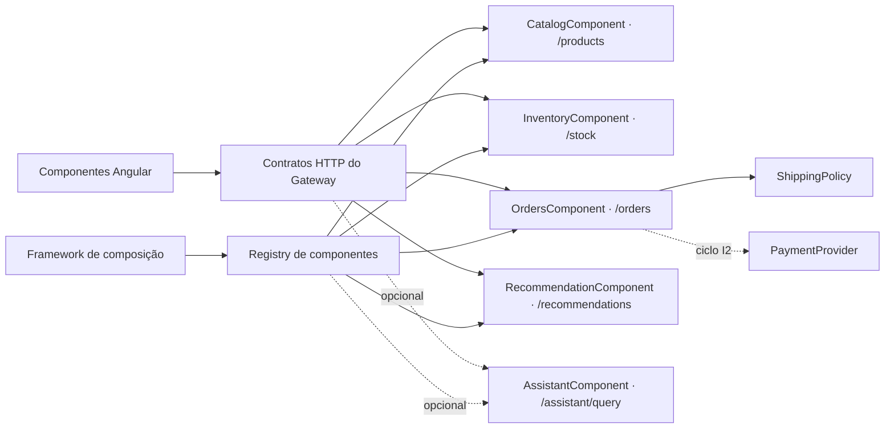
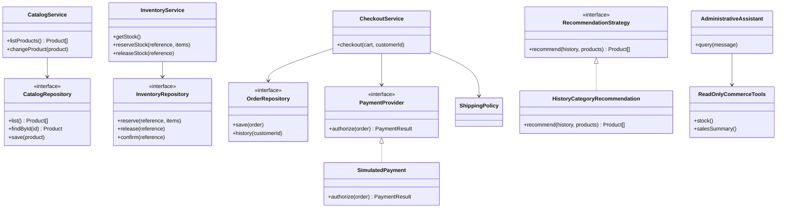

# Framework e componentes de software

## Estrutura implementada

O framework está em `backend/packages/framework/src/index.ts`. Ele controla a construção de aplicações com o padrão **Template Method**. `CommerceApplication.build()` mantém a sequência comum; `configure`, `shippingPolicy` e `registerExtensions` são os hotspots.



As variantes de entrega já são executáveis e verificadas no blueprint. O uso do valor na compra depende do checkout do ciclo I2. O método `build` não deve ser sobrescrito pelas aplicações: a extensão ocorre pelos métodos protegidos.

## Componentes e contratos



Os nomes `CatalogComponent`, `InventoryComponent` etc. identificam os componentes arquiteturais e seus contratos; não são classes já implementadas com esses nomes. Os controladores reais estão em `backend/services/<serviço>/src/main.ts`. O registro de composição não substitui testes funcionais.

## Classes por componente — desenho de destino para I2



Essas interfaces de persistência/pagamento ainda devem ser materializadas durante a implementação transacional. O diagrama deve ser atualizado com os nomes finais antes do relatório. As interfaces e as classes implementadas de entrega estão no diagrama anterior.

## Criar uma nova aplicação

1. Identifique as features e variantes; mantenha o core obrigatório.
2. Adicione uma classe que reutilize o framework. Exemplo de adaptação de marca:

```typescript
import { EssentialStore } from '@gerar/framework';
import type { ProductConfiguration } from '@gerar/contracts';

export class CampusStore extends EssentialStore {
  protected override configure(): ProductConfiguration {
    return {
      ...super.configure(),
      id: 'campus',
      name: 'Gerar Campus',
      accentColor: '#385c80',
    };
  }
}
```

3. Registre `campus` em `deriveProduct` e na lista de perfis de `backend/scripts/dev.mjs`.
4. Para uma nova feature, primeiro defina o contrato, suas dependências e o componente. Amplie a lista permitida e a validação. Registre o componente pelo hotspot `registerExtensions` somente quando a feature estiver selecionada.
5. Execute testes de composição, faça o build e gere os artefatos com `npm run derive -- campus`.
6. Execute a nova aplicação com `PRODUCT_PROFILE=campus`, seguindo o README gerado. Não copie `catalog`, `inventory`, `orders` ou o frontend para criar outra loja.

O exemplo de Campus é uma orientação de extensão, não um terceiro perfil já registrado no projeto.
