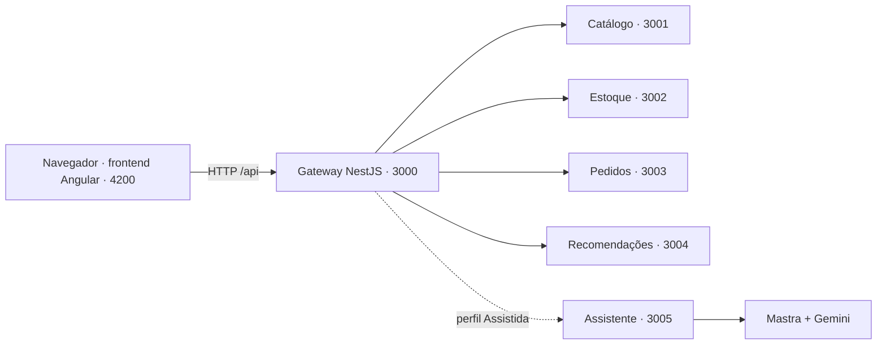

# Como o projeto está organizado

## Três responsabilidades visíveis

```text
gerar-commerce/
├── frontend/                 Interface Angular
│   ├── src/                  Telas, estilos e chamadas HTTP
│   ├── package.json          Dependências e comandos do frontend
│   ├── package-lock.json     Versões da instalação do frontend
│   ├── node_modules/         Instalação local do frontend, ignorada pelo Git
│   └── Dockerfile            Imagem da interface
├── backend/                  Servidor e framework
│   ├── services/             Gateway e microsserviços NestJS
│   ├── packages/
│   │   ├── framework/        Reuso, composição e variantes de loja
│   │   ├── contracts/        Tipos usados entre serviços do backend
│   │   └── platform/         Inicialização e utilitários técnicos do NestJS
│   ├── scripts/              Iniciar, compilar, testar e derivar produtos
│   ├── package.json          Workspace exclusivo do backend
│   ├── package-lock.json     Versões da instalação do backend
│   ├── node_modules/         Instalação local do backend, ignorada pelo Git
│   ├── .env.example          Modelo de configuração, incluindo Gemini
│   └── Dockerfile            Imagem dos serviços
├── docs/                     Arquitetura, explicações e backlogs
├── projeto_docs/             Materiais fornecidos pelas disciplinas
├── .github/scripts/          Gestão do GitHub e verificação da documentação
└── compose.yaml              Conecta os contêineres de frontend e backend
```

A raiz reúne a documentação, as instruções do projeto e o Compose. Não há `package.json`, lockfile ou `node_modules` na raiz. Angular, NestJS, Mastra e os compiladores de cada aplicação ficam nos projetos correspondentes. Os produtos gerados ficam em `backend/output/products/`.

## Como as partes conversam



1. O Angular monta a tela e pede os dados por HTTP.
2. O proxy do Angular encaminha `/api` ao gateway durante o desenvolvimento. No Docker, o Nginx faz esse encaminhamento.
3. O gateway identifica a configuração da loja e consulta os serviços responsáveis.
4. Os serviços respondem com JSON; o Angular usa esse JSON para exibir produtos, saldos e recomendações.
5. Na loja Assistida, o gateway também permite consultar o serviço de IA. A chave do Gemini pertence ao backend.

O frontend não importa arquivos do backend. Seus modelos descrevem os JSONs da API. Assim, cada lado instala e compila suas dependências de forma independente.

## Framework e linha de produtos

O framework é o código reutilizável em `backend/packages/framework/`. `CommerceApplication.build()` define a sequência comum: obter configuração, validar as features, registrar os componentes e escolher a política de entrega.

`EssentialStore` e `AssistedStore` reutilizam essa sequência e adaptam os pontos previstos: configuração da loja, política de entrega e registro da extensão de IA. Esses pontos de adaptação são os hotspots pedidos no trabalho de reuso.

A linha de produtos é a família de lojas que esse código consegue compor. O perfil Essencial usa o core e retirada na loja. O Assistida usa o mesmo core, entrega com tarifa fixa e o assistente opcional. O seletor atual mostra a composição dos dois perfis; a geração dos arquivos ocorre pelo comando `derive`.

## O que já funciona

Há interface navegável, consulta de catálogo e estoque, pedidos de exemplo, recomendação por histórico de exemplo, prévia dos dois perfis e APIs com indicação de saúde e portas. O framework gera os blueprints das duas lojas. Existe a integração inicial com Mastra/Gemini, ainda dependente de configuração e validação real.

Os dados atuais estão em memória ou em listas de exemplo. Ainda faltam persistência PostgreSQL, carrinho, checkout completo, operações reais de reserva de estoque e relatórios finais. O backlog registra essas entregas.

## Instalar e executar

Em um terminal:

```powershell
cd backend
npm ci
npm run dev
```

Em outro terminal, a partir da raiz do projeto:

```powershell
cd frontend
npm ci
npm run dev
```

Acesse http://127.0.0.1:4200. Instale e execute os comandos npm sempre dentro de `frontend/` ou `backend/`. Cada projeto mantém sua própria instalação.
