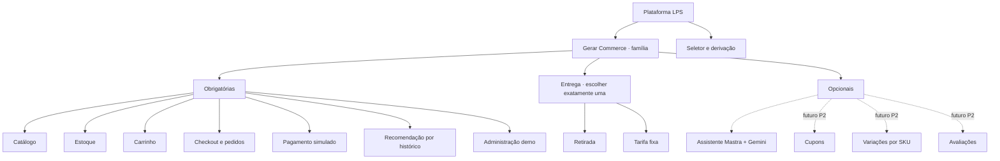
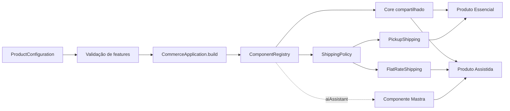

# Core, variantes e funcionalidades opcionais

## Critério

O core reúne o que torna toda derivação uma loja e o que é exigido pelos relatórios. Opcionais acrescentam capacidades sem impedir o funcionamento de uma loja básica. Variantes escolhem implementações alternativas de um mesmo ponto de variação.

| Capacidade                            | Classificação          | Justificativa / implementação                                        |
| ------------------------------------- | ---------------------- | -------------------------------------------------------------------- |
| Catálogo e preços                     | Core                   | Base de qualquer loja; serviço catalog                               |
| Estoque                               | Core                   | Família inicial de lojas de produtos físicos; serviço inventory      |
| Carrinho, checkout e pedidos          | Core                   | Fluxo mínimo de compra; interface + orders                           |
| Pagamento simulado                    | Core / adapter         | Comprovar fluxo sem operação financeira real                         |
| Entrega                               | Variante exclusiva     | Retirada ou tarifa fixa via ShippingPolicy                           |
| Recomendação por histórico            | Core                   | Exigência expressa do modelo de relatório de LPS                     |
| Administração de demonstração         | Core                   | Consultar/manter os dados que sustentam a demonstração               |
| Configurador e derivação              | Core da plataforma LPS | Selecionar features e construir produtos                             |
| Agente administrativo Mastra + Gemini | Opcional da loja       | Consultas de estoque e vendas; somente Assistida inicia esse serviço |
| Cupons                                | Opcional futuro        | Hotspot de preço; P2, fora da data mínima                            |
| Variações tamanho/cor                 | Opcional futuro        | Depende de catálogo e estoque por SKU; P2                            |
| Avaliações                            | Opcional futuro        | Componente removível; P2                                             |

## Modelo de features

Setas contínuas no grupo obrigatório representam features presentes em todos os produtos; o grupo Entrega é XOR; setas tracejadas representam opcionais. O Mermaid é uma representação visual com semântica explicitada nesta legenda, não uma ferramenta formal de SAT.

Restrições: `aiAssistant → administration ∧ inventory ∧ orders`; `recommendations → catalog ∧ orders`; `productVariants → catalog ∧ inventory`; exatamente uma modalidade de entrega. Hoje, a validação de core, valores conhecidos, duplicidade e modalidade está no framework; opcionais futuros ainda não são aceitos pelo código.

## Produtos de demonstração

| Ponto de variação   | Gerar Essencial                  | Gerar Assistida                                 |
| ------------------- | -------------------------------- | ----------------------------------------------- |
| Core                | Mesmo conjunto obrigatório       | Mesmo conjunto obrigatório                      |
| Entrega             | Retirada, R$ 0,00                | Tarifa fixa, R$ 15,00                           |
| Assistente          | Ausente; chave Gemini dispensada | Presente; Gemini configurado no backend         |
| Classe de aplicação | EssentialStore                   | AssistedStore                                   |
| Hotspots            | configure + shippingPolicy       | configure + shippingPolicy + registerExtensions |

Os dois produtos compartilham o mesmo catálogo de demonstração para evidenciar que a diferença está na composição e nos hotspots, sem exigir segmentos comerciais distintos. Cada perfil é executado separadamente na mesma porta de interface; duas execuções simultâneas exigem portas e nomes de projeto diferentes e ficam fora do incremento inicial.

