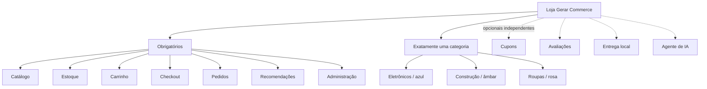
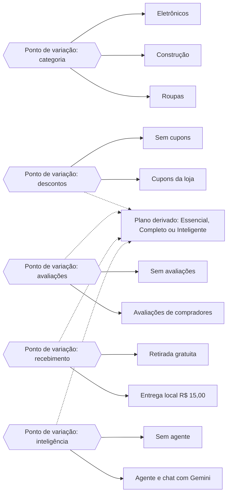

# Modelo de funcionalidades e variabilidade

## Core obrigatório

Catálogo, estoque, carrinho, checkout, pedidos, recomendações e administração são obrigatórios e aparecem marcados e bloqueados no cadastro. As operações de compra são simuladas; as entidades e os saldos são persistidos no PostgreSQL.

## Opcionais implementados

| Feature       | Componente                     | Comportamento quando selecionada                                     |
| ------------- | ------------------------------ | -------------------------------------------------------------------- |
| `coupons`     | Pedidos / política de desconto | Cupons cadastrados pela loja, com percentual, mínimo e validade      |
| `reviews`     | Catálogo                       | Compradores conectados avaliam produtos de compras aprovadas         |
| `delivery`    | Pedidos / ShippingPolicy       | Entrega local por R$ 15,00, preservando retirada gratuita            |
| `aiAssistant` | Mastra + Gemini                | Agente administrativo e chat público de dicas com links dos produtos |

Nenhum opcional permite remover o core. Sem a feature, a interface oculta a funcionalidade e o backend rejeita seu uso. A geração de três produtos no onboarding é uma ajuda da plataforma disponível a qualquer plano; não habilita o agente administrativo da loja.

Contas de compradores são uma regra obrigatória do checkout, sem novo adicional de plano. Cadastro, sessão e histórico pertencem à loja. O chat de produtos é público quando `aiAssistant` está selecionado; dados administrativos continuam restritos ao login do lojista.

## Pontos de variação e variantes

A categoria é obrigatória e exclusiva, e escolhe só o tema visual. Os demais pontos são opcionais e independentes: cada um tem uma variante ausente (padrão) e uma presente. O plano não é escolhido pelo cliente; resulta das variantes selecionadas, conforme a tabela abaixo. O vínculo ocorre em tempo de execução, no cadastro e nas alterações de configurações. As variantes presentes também ativam ou bloqueiam o comportamento correspondente no backend.

## Identidade e plano

Cada produto tem nome, slug único, descrição, capa, categoria e funcionalidades. O preço é derivado da composição, não escolhido livremente pelo cliente:

| Configuração                                 | Plano       | Valor fictício mensal |
| -------------------------------------------- | ----------- | --------------------: |
| Nenhum opcional                              | Essencial   |              R$ 59,90 |
| Qualquer combinação sem `aiAssistant`        | Completo    |              R$ 79,90 |
| `aiAssistant` com quaisquer outros opcionais | Inteligente |              R$ 99,90 |

As opções são independentes: contratar IA não marca automaticamente os outros opcionais. Todos os valores são de demonstração, sem integração de cobrança. Alterar opções no painel recompõe a loja e recalcula o plano. O slug permanece fixo para preservar os links.

## Binding e produtos

O binding ocorre em tempo de execução, no cadastro e nas alterações de configurações. As lojas coexistem na mesma implantação e usam rotas `/loja/:slug`. Exemplos possíveis: uma loja de eletrônicos só com core, uma de construção com cupons e entrega e uma de roupas com avaliações e IA. Todas usam o mesmo Angular, serviços e framework, com dados segregados por loja.
